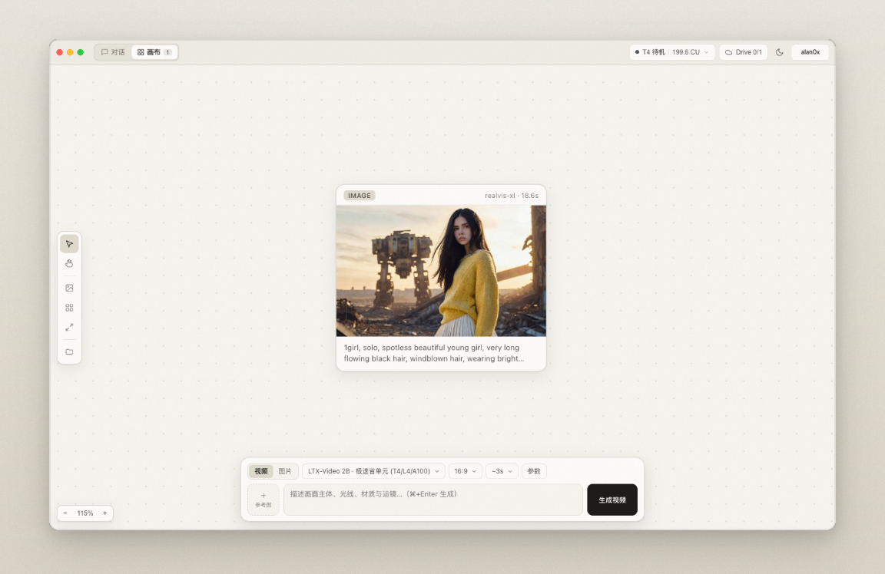
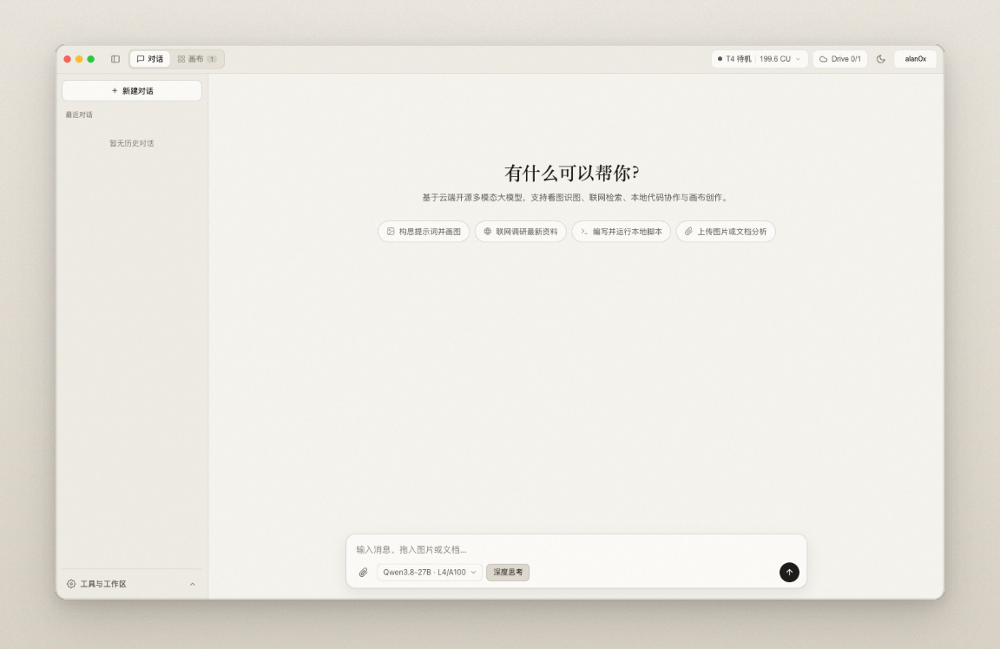
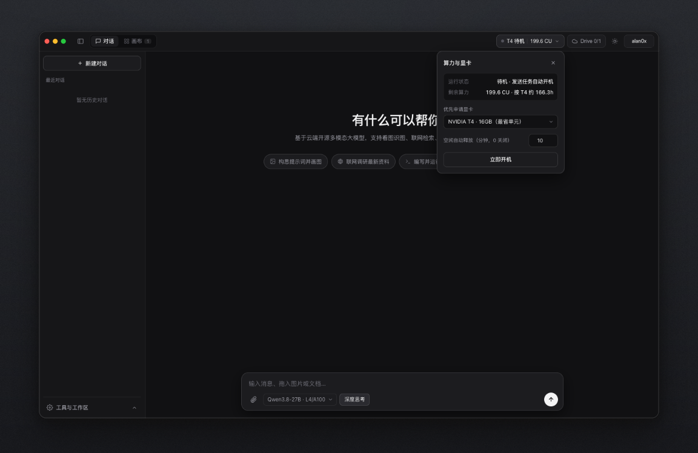
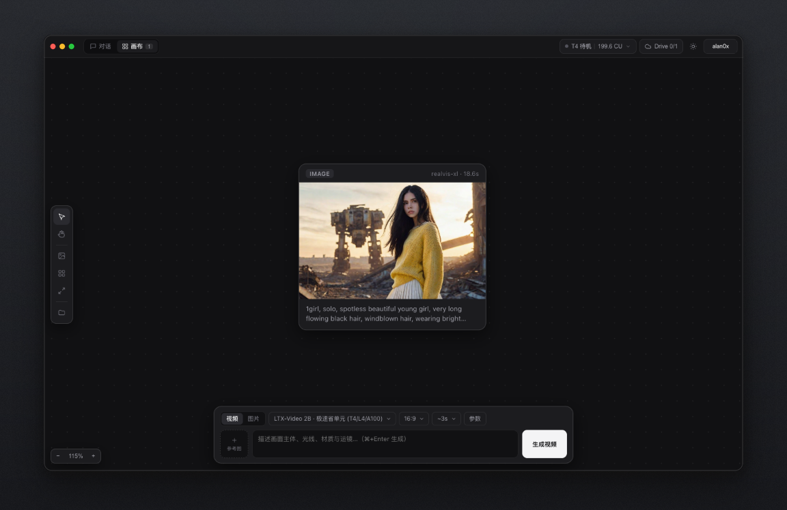
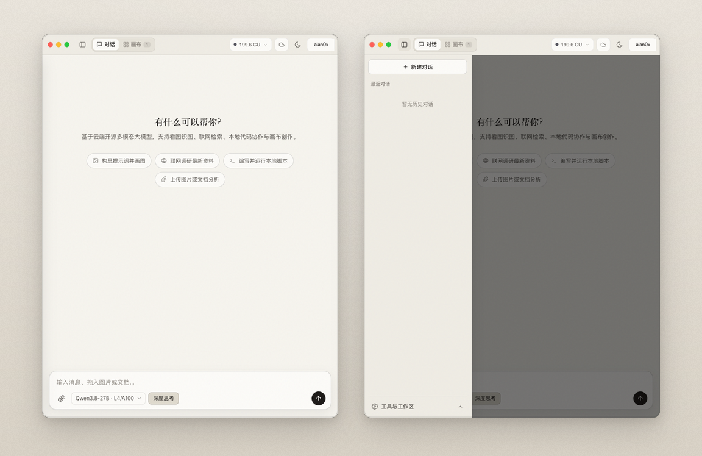

<div align="center">

# Colab Studio

**无需打开 Google Colab 网页的云端多模态 AI Agent & 无限创作画布桌面端**

基于官方 [`google-colab-cli`](https://pypi.org/project/google-colab-cli/)，把 Google One / Google AI Pro 赠送的 200 计算单元，变成一个集 **开源多模态 Agent（`Qwen3.8-27B`）** 与 **无限画布生图 / 视频** 于一体的 macOS & Windows 原生桌面工作台。

[](https://github.com/alan0x/colab-studio/releases/latest)
[](https://github.com/alan0x/colab-studio/releases/latest)
[](#核心能力)

[下载最新版 (v2.1.0)](https://github.com/alan0x/colab-studio/releases/latest) · [界面预览](#界面预览) · [核心能力](#核心能力) · [安装指南](#下载安装)

<br />



</div>

---

## 界面预览

支持默认 **Warm Archival Paper（浅色纸感）** 与 **Charcoal Dark（深色炭黑）** 一键切换，桌面顶栏与抽屉式侧边栏自适应任意分屏宽度。

<table>
  <tr>
    <td width="50%" align="center">
      
      <br />
      <sub><b>AI Agent 对话工作台 · 浅色纸感</b><br />直连云端 Qwen3.8-27B，支持深度思考、多模态附件与工具调用</sub>
    </td>
    <td width="50%" align="center">
      
      <br />
      <sub><b>算力余额与显卡浮层 · 深色炭黑</b><br />实时查看剩余 CU 与可用时长，支持 T4 / L4 / A100 切换与空闲自动关机</sub>
    </td>
  </tr>
  <tr>
    <td width="50%" align="center">
      
      <br />
      <sub><b>无限创作画布 · 深色炭黑</b><br />自由拖拽缩放、图生视频连线编排与云盘自动同步</sub>
    </td>
    <td width="50%" align="center">
      
      <br />
      <sub><b>窄屏分屏自适应</b><br />窄窗口下顶栏自动精简，侧边栏平滑切换为滑出式抽屉</sub>
    </td>
  </tr>
</table>

---

## 核心能力

1. **全能多模态 AI Agent 工作台（直跑 `Qwen3.8-27B` 等开源大模型）**
   - 在 Colab GPU 上自动启动预编译 CUDA `llama-server`，支持 **`Qwen3.8-27B`**（L4/A100 旗舰全模态 + T4 Q2 轻量版）、**`Qwen3.5-9B`** 与 **`Qwen2.5-VL-7B`**。
   - 原生支持**发图识图、上传代码/文档、深度思考链折叠、流式输出与多会话历史管理**。
   - 内置四大 Agent 工具套件：
     - **联动无限画布**：自然语言指挥 Agent 构思提示词、调用生图/图生视频并自动落入画布与 Google Drive（单卡自动显存热切换）。
     - **实时联网搜索与网页正文抓取**。
     - **本地工作区文件与终端**：读写本地项目文件、运行 Python/Shell 脚本（默认带行内安全确认，严格限定在工作区目录内）。
2. **无限创作画布（Infinite Canvas）**
   - 自由拖拽、缩放（25%–200%）、抓手平移、一键整齐排版。
   - **直接拖入本地图片到画布**作为参考素材，选中任意图片点击 **「以此图生视频」**，生成的视频卡片会通过贝塞尔曲线与原图自动连线。
   - 内置开箱即用无门控模型：`RealVisXL V5.0`、`Animagine XL 4.0`、`阿里 Z-Image Turbo`、`Shuttle 3.1`、`LTX-Video 2B`、`阿里 Wan 2.2 TI2V-5B`、`Wan 2.1 1.3B`。
3. **Google Drive 自动云端同步**
   - 复用同一次 Google OAuth 授权（自带 `drive.file` 权限，**无需额外登录**）。
   - 所有参考素材、生成图片/视频及画布布局自动备份到 `Google Drive / ColabCanvasStudio/`，支持一键双向恢复。
4. **实时显卡 & 算力余额守护**
   - 顶部紧凑状态栏实时显示当前显卡、真实剩余计算单元（CU）与预计可用小时数；支持默认 10 分钟空闲自动释放算力与一键关机。

---

## 下载安装

前往 [GitHub Releases](https://github.com/alan0x/colab-studio/releases/latest) 下载对应系统的独立桌面安装包：

### Windows 10 / 11（免配环境 · 开箱即用）
- **安装版（推荐）**：下载 `Colab-Canvas-Studio-v2.1.0-Windows-x64-Setup.exe`，双击安装即可（内置 Python、WebView2 桌面壳与 `google-colab-cli`，**无需安装任何依赖**）。
- **绿色便携版**：下载 `Colab-Canvas-Studio-v2.1.0-Windows-x64-Portable.zip`，解压后直接运行 `Colab Canvas Studio.exe`。
- 打开后点击右上角 **「登录 Google」** 完成一次授权即可开始使用，作品默认保存在 `文档\ColabCanvasStudio\outputs` 并自动同步至 Google Drive。

### macOS（Apple Silicon）
下载 `Colab-Canvas-Studio-v2.1.0-macOS-arm64.dmg`：

1. 打开 `.dmg`，将 **Colab Canvas Studio.app** 拖入 **Applications** 文件夹。
2. 安装 Google 官方 Colab CLI（仅需一次）：
   ```bash
   uv tool install google-colab-cli
   # 或 pip3 install google-colab-cli
   ```
3. 首次打开如遇 macOS “无法验证开发者”提示（开源自签名应用），在终端执行一次放行命令即可：
   ```bash
   xattr -cr "/Applications/Colab Canvas Studio.app"
   ```
4. 打开 **Colab Canvas Studio**，点击右上角 **「登录 Google」** 完成授权即可开始创作。

### 从源码构建 macOS `.app` 和 `.dmg`
```bash
./scripts/build_mac_app.sh 2.1.0
```

---

## 快速启动（开发模式）

1. 双击根目录的 **`启动 Colab Media Studio.command`**（或在终端运行 `python3 local_app/server.py`）。
2. 首次打开点击右上角 **「登录 Google」**，按弹窗 2 步完成 Google 官方 OAuth 授权即可记住登录态。
3. 在「对话」页直接提问、发图或指挥 Agent 画图，或在「画布」页拖入参考图与输入提示词生成图片和视频；系统会自动按需申请所选显卡（L4 / T4 / A100，缺货自动降级）并在空闲时自动释放。

---

## 目录说明

- `启动 Colab Media Studio.command` — macOS 一键启动器
- `local_app/server.py` — 本地 Agent / 无限画布后端、SSE 流式接口与作品库 API
- `local_app/colab_manager.py` — 基于 `google-colab-cli` 的 OAuth、算力余额查询、GPU/LLM 启停、文件传输与空闲自动关机守护
- `local_app/agent_engine.py` & `local_app/agent_tools.py` — 流式多模态 ReAct Agent 引擎与工具套件
- `local_app/remote_worker.py` & `local_app/remote_llm_server.py` — 远程常驻内核 Diffusers 推理与预编译 CUDA `llama-server` 托管
- `local_app/drive_manager.py` — Google Drive REST API v3 双向同步
- `local_app/static/` — 浅色纸感 & 深色炭黑响应式桌面前端（HTML / CSS / JS）
- `macos/` & `windows/` — macOS (`WKWebView`) 与 Windows (`PyInstaller + pywebview + Inno Setup`) 桌面打包工程
- `docs/screenshots/` — README 展示截图资源
